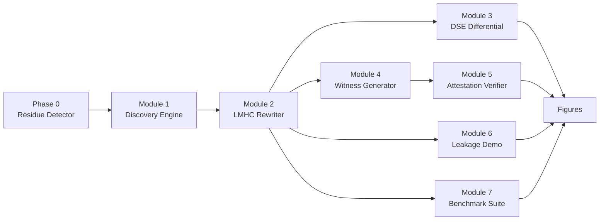

# LMHC-Forge


-success)

**Measured evidence, not estimates, for the Local Memory Hygiene Contract
(LMHC)** — a specification and reference implementation for closing GPU
shared-memory residue (the LeftoverLocals / CVE-2023-4969 class) at the
source, with compliance a relying party can independently verify.

This repository is the **evaluation artifact**: real measurements on
consumer NVIDIA GPUs (RTX 3050, RTX 3060 Ti, RTX 4050) that replace every
`[[MEASURE: ...]]` placeholder in the accompanying paper — residue recovery
along three memory-lifecycle paths, compiler dead-store-elimination behavior,
per-exit scrub overhead (both timing and power), an analytical cost model,
and independent-verifier cost — with numbers from a real GPU, not estimates.

## Pipeline



Beyond this core pipeline, the artifact also measures residue along two
additional lifecycle paths (register/shared spill, explicit global staging),
unforced/natural scheduler placement, jitter-free on-device timing, an
analytical overhead model, verifier cost, and sustained-load power draw —
see [`docs/RESULTS.md`](docs/RESULTS.md) for the complete claim mapping.

## Key results (honest framing)

| Claim | Measured result |
|---|---|
| Cross-kernel shared-memory recovery rate | **EI 1.000 → 0.000** with the LMHC hardened scrub (N=200, RTX 4050); replicated on RTX 3050 (1.000→0.000) and RTX 3060 Ti (0.995→0.000) |
| Scrub overhead, three kernel classes | Below CUDA-event timing noise floor; **resolved via on-device `clock64()`**: 209/62/164 ns per exit (reduction/GEMM/attention) |
| DSE hazard (dead-store elimination) | **Ordering differential** on shipping ptxas 12.8/13.3 (elimination not observed, across an 8-way flag sweep); a generic LLVM `-O2` exhibit confirms the hazard is real and semantic, not hypothetical |
| Independent attestation verifier | **T1–T6 tamper ladder**: T1–T5 correctly rejected; T6 (source-trust boundary) is a documented, measured limitation |

Every number above carries a mandatory framing: this is **in-process,
same-context residue** — it validates the window LMHC is designed to close,
not a reproduction of cross-tenant LeftoverLocals on NVIDIA (NVIDIA was not
reported affected by that specific path). Full framing, scope, and every
other measured claim (P-spill/P-stage, unforced co-residency, the analytical
model, verifier cost, power draw): **[`docs/RESULTS.md`](docs/RESULTS.md)**.

## Quickstart

```bash
git clone https://github.com/triptiiSharma/lmhc-forge.git /opt/lmhc-forge
cd /opt/lmhc-forge
bash run_all.sh
```

Requires WSL2 + CUDA 12.8 toolkit + gcc-14 + a one-time glibc patch — full
prerequisites, the complete repository layout, and how to reproduce every
Phase-1 addition individually: **[`docs/SETUP.md`](docs/SETUP.md)**.

## Documentation

| Document | Contents |
|---|---|
| [`docs/RESULTS.md`](docs/RESULTS.md) | Full claim-mapping table, every module's measured result, methodology & scope |
| [`docs/SETUP.md`](docs/SETUP.md) | Prerequisites, environment patches, full reproduction steps |
| [`docs/SPEC.md`](docs/SPEC.md) | Build specification — source of truth for what this artifact claims and why |
| [`docs/INTERPRETATION.md`](docs/INTERPRETATION.md) | Multi-GPU replication: pre-committed outcome readings (written before results) |
| [`multi_gpu/README.md`](multi_gpu/README.md) | Multi-GPU collaborator flow (`bash multi_gpu/run.sh`) |

## Hardware

All measurements are from consumer GPUs and labeled per-device: RTX 4050
Laptop GPU (Ada Lovelace, sm_89, primary target), RTX 3050 Laptop GPU and
RTX 3060 Ti (Ampere, sm_86, multi-GPU replication). The paper's reference
target is the H100 (228 KB shared/SM); relative overhead and qualitative
findings generalize, absolute timing/power numbers do not.

## Limitations

Single-block/single-exit rewriter scope, in-process vs. cross-tenant scope,
the T6 source-trust boundary, a P-spill negative finding specific to this
WSL2/driver configuration, and other honestly-reported gaps are documented
in full in [`docs/RESULTS.md`](docs/RESULTS.md) and [`docs/SPEC.md`](docs/SPEC.md).

## Citation

```bibtex
@inproceedings{sharma2025lmhc,
  author    = {Tripti Sharma and Arshad Ali and Guruansh Singh},
  title     = {Toward Verifiable Per-Kernel Memory Hygiene on Consumer {GPUs}: The Local Memory Hygiene Contract and Its Reference Implementation},
  booktitle = {TBD},
  year      = {TBD},
}
```

## License

MIT — see [LICENSE](LICENSE).
